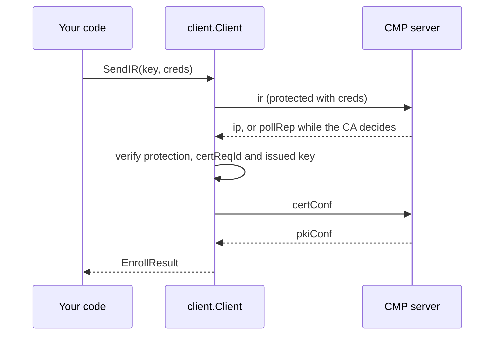
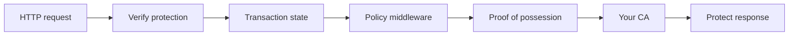

# Architecture

How the packages divide the work and what happens to a request on each side.

## Packages

| Package | Role | Depends on |
| --- | --- | --- |
| `pkicmp` | ASN.1 types for CMP and CRMF, message construction, parsing, MAC and signature protection, verification, proof of possession | golang.org/x/crypto, go-composite-mldsa, circl |
| `cms` | EnvelopedData and EncryptedValue for proof of possession by decryption | golang.org/x/crypto |
| `client` | Request flows over HTTP: protection, response verification, polling and confirmation | `pkicmp`, `cms` |
| `server` | An `http.Handler` with transactions, policy middleware and the CA interfaces | `pkicmp`, `cms` |

`pkicmp` stands alone. Use it directly for custom tooling, a registration authority proxy or tests
that need to build or inspect messages. See [Messages and protection](pkicmp/messages-and-protection.md).

## Client

A `Client` holds an endpoint and configuration only. Each `Send*` or `Get*` call runs one complete
operation and keeps its transaction state, such as the transaction ID and nonces, for that call
alone. One `Client` can therefore serve many goroutines.

The call returns only after the whole exchange, including polling and confirmation. A context
deadline bounds it. [Enrollment](client/enrollment.md) and
[Response verification](client/response-verification.md) describe each step.

## Server

`server.NewCAServer` wraps your `CA` in a handler, applies the policy middleware and returns a
`Server` that implements `http.Handler`. `server.New` takes any `Handler` instead, for full control
such as custom routing or a registration authority proxy.

Every request passes these stages in order:

1. **HTTP checks.** Only `POST` with `Content-Type: application/pkixcmp` is accepted. Bodies are
   limited by `server.MaxRequestBodySize`, 1 MiB by default.
2. **Header checks.** The protocol version must be 2 or 3 and a recipient the server does not
   answer to is refused.
3. **Protection.** The MAC is checked with the secret from `SecretLookup` or the signature with the
   certificate from `CertificateLookup`. The result is a `SenderIdentity`.
4. **Transaction checks.** Nonces, the transaction ID and the transaction limits are checked
   against the state of the sender's transaction.
5. **Policy middleware.** `LightweightPolicy` and your own middleware accept or refuse the request.
6. **Built-in request checks.** The handler that `NewCAServer` builds verifies proof of possession
   and decodes BasicConstraints for every certificate request, with or without a policy.
7. **Your CA.** `IssueCertificate`, `RevokeCertificate`, `CheckPending` or a support message
   provider decides the answer.
8. **Response.** The server protects the response with the MAC of a MAC-protected request or else
   with the `WithSigner` key. It then records the transaction state.

A refusal at any stage becomes a CMP error message or the rejection in an `ip`, `cp`, `kup` or `rp`
where RFC 9810 asks for one. An error your code returns that is not a `*server.Error` becomes a bare
systemFailure, so internal detail never reaches the peer.

## Transactions

The server keys each transaction by the sender's verified credential and the transaction ID. One
client cannot continue or hijack another client's transaction even with the same transaction ID.
Transactions live in memory:

* `CleanupExpired` removes completed and stale transactions and must be called periodically.
* `WithMaxTransactions` and `WithMaxTransactionsPerCredential` cap the state a client can create.
* `SnapshotTransactions` and `RestoreTransactions` move the state to durable storage or a new
  process.

[Transactions and recovery](server/transactions.md) describes each.

## What your code supplies

| Concern | Library | Your code |
| --- | --- | --- |
| Wire format, protection, nonces, transactions | Yes | No |
| Proof of possession | Yes | Decides on indirect methods through the options |
| Who may request which certificate | No | Middleware or `IssueCertificate` |
| Shared secrets and known certificates | Lookup interfaces | The store behind them |
| Certificate contents, serial numbers and validity | Template from the request | Every final decision before signing |
| Revocation, CRLs and CA certificates | Protocol handling | The data and the decision |
| TLS, rate limiting and audit logging | No | HTTP server and middleware |
