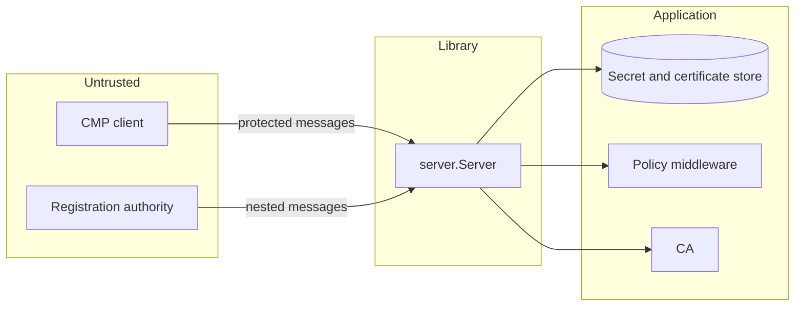

# Security model

What the library checks, what it assumes about your application and where you must add your own
controls.

## Trust boundaries

Clients and registration authorities are untrusted until their protection is verified. The lookups,
the policy and the CA are trusted application code.

On the client side the CA is untrusted until its response is verified against your anchors or the
shared secret.

## What the server enforces

**Message authentication.** Every message is verified before your code sees it: a MAC with the
secret your lookup returns or a signature with the certificate it returns. A signed message must name
the certificate subject as its sender. The MAC iteration count is bounded before any key derivation,
so an unauthenticated request cannot buy unbounded work.

**Transaction binding.** Transactions are keyed by the verified credential and the transaction ID.
Every message after the first must repeat the previous senderNonce. One client cannot continue,
confirm or poll another client's transaction.

**Proof of possession.** A certificate is never issued for a key the requester did not prove
holding, with or without a policy. An encrypted certificate counts as delivered only after a
`certConf` with its hash.

**Revocation authority.** By default only the certificate being revoked may sign its revocation.
Everything else goes to your `RevocationAuthorizer`.

**Error disclosure.** An error your code returns that is not a `*server.Error` becomes a bare
systemFailure. Its text never reaches the peer.

**Bounded parsing.** Request bodies, transaction counts and snapshot sizes are limited. Every parser
in `pkicmp` reads bytes a peer chose, before anything establishes who that peer is, so the
whole-message parser, MAC parameters, signature verification and the SLH-DSA key and signature
checks have fuzz targets that CI runs.

## What the client enforces

* Every response is verified with the shared secret or against the trust anchors.
* The transaction ID, nonces and `certReqId` must match the request.
* The issued certificate must certify the requested key and chain to the anchors.
* A centrally generated private key must carry a valid signature and match the issued certificate.
  With trust anchors its signer must chain to them and be a key generation authority.
* `caPubs` extend the anchors only for a MAC-protected response and never with `WithoutCAPubsTrust`.
* Waits between polls are clamped and the response size is limited.
* An unverified error status is reported as `UnverifiedStatusError` and never as a
  `PKIStatusError`, so code that acts on failure bits cannot be steered by a forged error.

## What your application must provide

| Concern | Your responsibility |
| --- | --- |
| Authorization | Middleware or `IssueCertificate` decides who may request which certificate. Without it any authenticated client gets any name |
| Unique shared secret references | Two clients with one reference cannot be told apart |
| Certificate store | `CertificateLookup` returns only certificates you trust and no revoked ones |
| Certificate contents | Remove requested extensions before you set your own and check every subject attribute |
| CA key protection | `WithSigner` takes a `crypto.Signer`, so the key can stay in an HSM |
| Encrypted certificates | Publish only after `ConfirmAccepted` and revoke on `ConfirmExpired` or `ConfirmRejected` |
| Central key generation | The `KeyGenerator` keeps no copy of a private key it hands out unless your key archive policy needs one. The key generation authority key is protected like the CA key |
| Registration authorities | The `RAAuthorizer` must identify the RA itself, not only a valid protection |
| Transport | TLS if the deployment needs confidentiality. CMP protection gives integrity and authentication only |
| Rate limiting and audit | Middleware. The library has no rate limits beyond the transaction caps |
| Durable state | Snapshots and a response cache when the server must survive restarts or retries |

## Options that weaken checks

The compatibility options in [Policy and client compatibility](../server/policy.md) each relax one
rule. They keep the checks that authenticate a request, but some remove a binding:

* `WithPoposkInputVariants` accepts a proof that does not cover the template, so only the message
  protection binds the requested names to the key holder.
* `WithOptionalPollReqRecipNonce` lets a recorded `pollReq` of the same transaction collect the final
  response. That response holds no secret in the clear. A centrally generated key in it is
  encrypted for the requester.
* `WithMACRevocation` lets a shared secret revoke. Your `RevocationAuthorizer` decides which
  certificates.
* `WithSHA1Signatures` accepts a deprecated hash.

## Reporting

Report suspected vulnerabilities privately as
[SECURITY.md](https://github.com/misiektoja/go-pki-cmp/blob/main/SECURITY.md) describes. Only the
latest release receives fixes.
